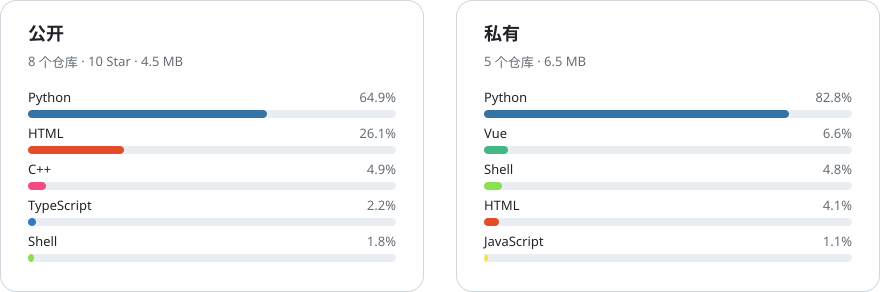

  

<h2 align="center">XUTG</h2>

大模型推理 · 科学信息抽取 · 教育与金融系统

  <picture>
    <source media="(prefers-color-scheme: dark)" srcset="assets/stats-dark.svg">
    
  </picture>

  <a href="https://github.com/uiber3015/BioTRACE">
    <picture>
      <source media="(prefers-color-scheme: dark)" srcset="https://github-readme-stats.vercel.app/api/pin/?username=uiber3015&repo=BioTRACE&theme=dark&hide_border=true">
      
    </picture>
  </a>
  <a href="https://github.com/DeepCodingInTuringAcademy/Habbit">
    <picture>
      <source media="(prefers-color-scheme: dark)" srcset="https://github-readme-stats.vercel.app/api/pin/?username=DeepCodingInTuringAcademy&repo=Habbit&theme=dark&hide_border=true">
      
    </picture>
  </a>

  <a href="https://github.com/UIBER2023/FinanceAI">
    <picture>
      <source media="(prefers-color-scheme: dark)" srcset="https://github-readme-stats.vercel.app/api/pin/?username=UIBER2023&repo=FinanceAI&theme=dark&hide_border=true">
      
    </picture>
  </a>
  <a href="https://github.com/uiber3015/EduInteractivateGame">
    <picture>
      <source media="(prefers-color-scheme: dark)" srcset="https://github-readme-stats.vercel.app/api/pin/?username=uiber3015&repo=EduInteractivateGame&theme=dark&hide_border=true">
      
    </picture>
  </a>

  <a href="https://github.com/uiber3015/EducationalSeriousGame_Demo">
    <picture>
      <source media="(prefers-color-scheme: dark)" srcset="https://github-readme-stats.vercel.app/api/pin/?username=uiber3015&repo=EducationalSeriousGame_Demo&theme=dark&hide_border=true">
      
    </picture>
  </a>
  <a href="https://github.com/UIBER2023/CycleGAN-Photo2Monet">
    <picture>
      <source media="(prefers-color-scheme: dark)" srcset="https://github-readme-stats.vercel.app/api/pin/?username=UIBER2023&repo=CycleGAN-Photo2Monet&theme=dark&hide_border=true">
      
    </picture>
  </a>

  <a href="https://github.com/DeepCodingInTuringAcademy">DeepCodingInTuringAcademy</a>
  &nbsp;·&nbsp;
  <a href="https://github.com/UIBER2023">UIBER2023</a>

